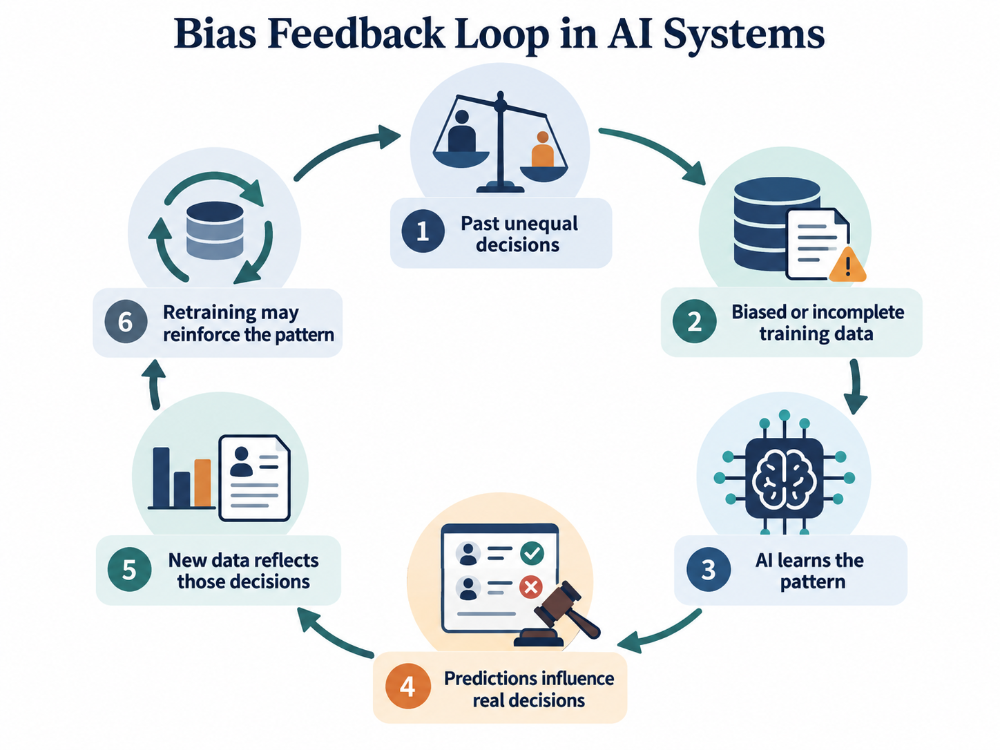
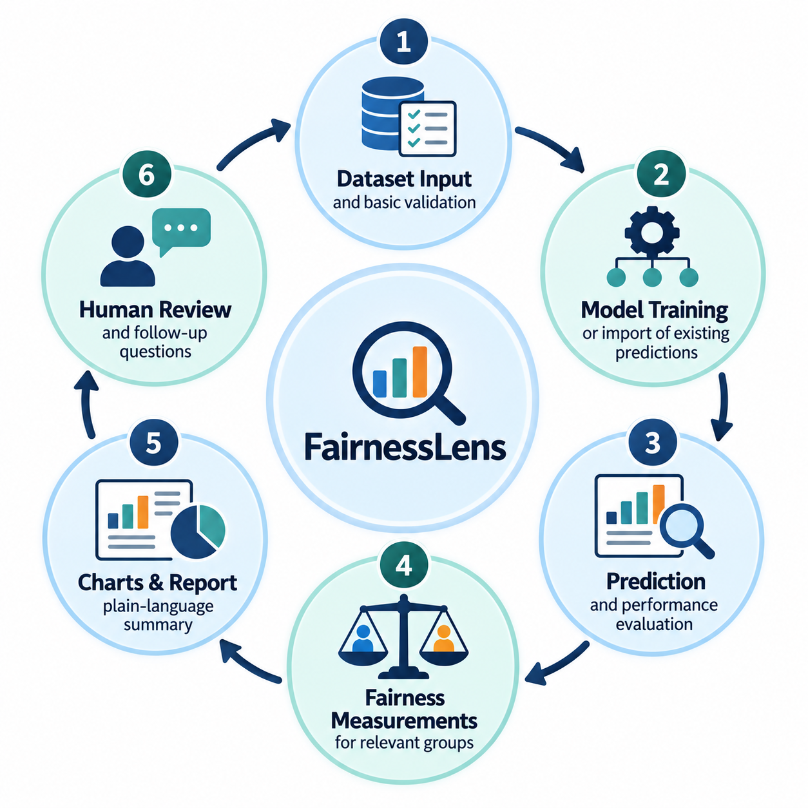

# Algorithmic Bias and Social Inequality

Does Artificial Intelligence Reduce Inequality or Reproduce It?

**Author**: Isse S. Ibrahim

**Course**: Building AI

**Institution**: University of Helsinki

**Course developed by**: University of Helsinki and Reaktor

**Building AI course project**

**Date**: October 2026

**Application**: FairnessLens, an Algorithmic Fairness Auditing Tool

**Project Status**: Research proposal; software development and testing are planned.

## Summary

Artificial intelligence influences who sees job ads, gets recommended for employment, receives loans, and finds information online. This project studies how AI may repeat social inequality and proposes FairnessLens, a tool for checking unfair patterns in automated decisions.

### Abstract

Artificial intelligence (AI) is used in employment, advertising, housing, finance, and other important areas. AI can help people make decisions, but it may also repeat unfair patterns found in past data. This project explores how bias enters AI systems, how it can grow through feedback loops, and why high accuracy does not always mean fair outcomes. It proposes FairnessLens, a Python-based tool that would compare predictions and error rates across groups, explain possible problems, and support human review. The project is a proposal, not a finished or tested application.

### Central research question

> *When artificial intelligence learns from a society that already contains inequalities, does it learn to correct those inequalities, or reproduce them?*

## Background

AI is often described as objective because it uses mathematics and data. But a computer does not automatically know what is fair. People decide which data to collect, what an AI system should predict, and how its results will be used.

An old computer science idea is “Garbage In, Garbage Out” (GIGO): poor input can lead to poor output. If a model learns from incomplete data or past unfair decisions, it may repeat those patterns. Bias can also come from the way a model is designed, the goals it is trained to achieve, or the setting in which it is used.

For example, a hiring model trained on past hiring decisions may learn which candidates were previously selected rather than who is genuinely qualified. AI can scale that problem to many decisions unless people test its results.

### Why I Chose This Topic

I chose this topic because I am interested in how technology affects people's lives and opportunities. As a software development and ICT student, I want to understand not only how AI works, but also how it affects different people. I believe developers should consider fairness and responsibility when designing systems that influence important decisions.

### Real-world areas this project examines

### 1. Employment and hiring

Employers may use software to screen CVs and rank job applicants. If past hiring records favored one group, a model trained on those records could rank similar applicants higher. Skills, job history, career gaps, and schools attended can also reflect unequal access to opportunity. A fair review should ask whether a model measures real job-related ability rather than simply repeating old choices.

### 2. Gender equality and online advertising

Online advertising systems decide which people see which ads. In a 2015 study, Datta and colleagues found that simulated male and female profiles were shown high-paying career advertisements at different rates. The study raised concerns about unequal access to job information, while not proving that the algorithm alone caused the difference. A person can miss an opportunity without ever knowing it existed.

### 3. Racial representation and search results

Search engines, autocomplete, and advertising can affect a person’s reputation. In 2013, Latanya Sweeney reported that searches for names associated with Black people were more likely to show ads suggesting an arrest record than searches for names associated with White people. The study concerned advertisement delivery; it did not establish that the searched individuals had arrest records. This shows why online results should be examined for harmful associations.

### 4. Criminal justice and predictive policing

Some tools use past records to estimate future risk. But arrest records can be affected by where police have worked, how reports were made, and what incidents were recorded. A system that treats these records as a complete picture may produce misleading predictions. Risk assessments can also make different kinds of mistakes across groups. Because the stakes are high, these tools need careful testing, transparency, and human accountability.

### 5. Housing, mortgages, and finance

Credit and mortgage models can use income, payment history, and financial records. But those records may reflect unequal access to housing, work, and wealth in the past. Even when race or gender is removed from a dataset, other variables—such as location—may still be related to protected characteristics. Unequal outcomes require investigation; they do not, on their own, prove illegal discrimination.

### 6. Access to opportunities

Recommendation systems also influence which jobs, courses, scholarships, and financial products people discover. If a system only shows options similar to a person’s past choices, it may overlook their new interests and potential. This project asks whether AI can widen opportunities instead of keeping people in the same patterns.

### How bias can create a feedback loop

AI systems can change the world they measure. If an algorithm recommends mainly one type of applicant, employers may interview more of those applicants. Later, new hiring records may appear to support the original pattern. When the model is retrained, that pattern can become even stronger.

This is called a feedback loop. It is one reason why model developers must study how data is created, not just how well a model predicts it.

### The black box problem

Some AI models are hard to explain. A person may want to know why an application was rejected or a loan was declined, but a complex model may not give a simple answer. Tools such as feature importance and SHAP can help explain which inputs affected a prediction. These explanations can be useful, but they do not prove that a model is fair or reveal the true social cause of a disparity.

### Proposed solution: FairnessLens

FairnessLens is a proposed Python tool for checking possible unfair patterns in AI predictions. It would not make hiring or lending decisions. It would help developers, students, and researchers examine the results of another model. The first example would use a synthetic hiring dataset rather than real private applicant information.

## How is it used?

A user would choose a sample dataset or provide data that can legally and safely be analyzed. FairnessLens would check the data, use an existing prediction model or train a simple example model, calculate prediction accuracy, compare outcomes across groups, and produce charts and a short report. A human reviewer would then decide which differences need deeper investigation.

FairnessLens would mainly be designed for students, researchers, software developers, and organizations that want to evaluate automated decisions. People affected by AI systems could also benefit from clearer explanations of how these systems are evaluated.

### Proposed workflow

### Fairness measurements

There is no single number that proves whether AI is fair. FairnessLens would examine several measures, where the needed data is available and the measures make sense for the task.

| Measure            | Simple meaning                                                                   |
|--------------------|----------------------------------------------------------------------------------|
| Demographic parity | Do groups receive positive predictions at similar rates?                         |
| Equal opportunity  | Among people with positive true outcomes, are true-positive rates similar?       |
| Equalized odds     | Are true-positive and false-positive rates similar across groups?                |
| Predictive parity  | Among positive predictions, are the correct-positive rates similar?              |
| Calibration        | For the same predicted probability, do observed outcomes occur at similar rates? |

Different fairness measures can disagree. For example, when groups have different outcome rates, some criteria may not be possible to satisfy at the same time. FairnessLens would show these trade-offs rather than claim that one metric settles every question.

## Data sources and AI methods

The first experiment would use invented, clearly labeled data showing fictional applicants, qualifications, recommendations, and group information. Synthetic data makes it easier to test ideas without exposing anyone’s private records. Later work could use carefully selected, properly licensed research datasets, if their limitations and data-use rules are understood.

| Tool / method                         | Planned role                                                   |
|---------------------------------------|----------------------------------------------------------------|
| Python                                | Write and organize the project code                            |
| NumPy and pandas                      | Work with tables and numerical data                            |
| scikit-learn                          | Train and test a basic classifier, such as logistic regression |
| Matplotlib                            | Create simple charts                                           |
| Train/test split and cross-validation | Test predictions on data not used for training                 |
| Group-based fairness measures         | Compare selection rates and prediction errors                  |

A possible experiment would compare a model trained on balanced example labels with one trained on labels shaped by an unfair historical rule. We would then test the two models on separate synthetic data and see whether the difference appears in their predictions. This would be an educational demonstration, not proof about a real employer.

### Potential benefits

- Help developers spot patterns that deserve investigation.

- Help students learn the difference between accuracy and fairness.

- Make model results easier to discuss with nontechnical people.

- Support documentation, transparency, and meaningful human review.

- Encourage better questions about access to jobs, housing, and information.

## Challenges

- Unequal results do not automatically prove discrimination; the context and causes matter.

- Synthetic examples can teach methods but cannot show how often bias occurs in the real world.

- Protected attributes and other private information require careful, lawful handling.

- Different fairness measures may conflict, and small samples can give unreliable comparisons.

- Data labels such as “successful candidate” may already reflect unfair decisions.

- Removing race or gender fields may not remove indirect signals (proxy variables).

- Explanations are not the same as proof of fairness or causation.

- Human reviewers can also be biased; oversight must be informed and accountable.

- FairnessLens would be a diagnostic aid, not a legal judgment or automatic bias-removal system.

## What next?

The following phases describe how I plan to develop FairnessLens in the future.

### Phase 1: Research

Read and cite case studies on recruitment, advertising, search results, criminal justice, and finance.

### Phase 2: Basic Python experiment

Create a synthetic dataset and use logistic regression to produce predictions.

### Phase 3: Fairness calculations

Compare selection rates and error rates across groups, checking uncertainty and sample sizes.

### Phase 4: FairnessLens dashboard

Show results in charts with simple explanations and important warnings.

### Phase 5: Improvement and collaboration

Study possible ways to reduce disparities, test trade-offs, and seek feedback from people with different expertise.

### Conclusion

AI is not automatically fair or unfair. Its effects depend on its training data, design choices, goals, testing, and use. When historical inequalities are built into data or decision processes, AI may repeat or increase those inequalities. At the same time, AI tools can help us find patterns that need attention.

FairnessLens is a proposal to make those patterns easier to measure and explain. It would show that a model should be judged not only by accuracy, but also by how its errors and results affect different people. No software tool can solve social inequality by itself. Building trustworthy AI requires good evidence, careful design, transparency, and people willing to take responsibility for decisions.

**The question is not only what AI can predict, but how we choose to use those predictions.**

## Acknowledgments

This project was prepared for the Building AI course by the University of Helsinki and Reaktor. FairnessLens is a proposed idea. The studies and resources below provide background; any future code, images, or datasets should be credited according to their licenses.

- Sweeney, L. (2013). Discrimination in Online Ad Delivery. ACM Queue. https://doi.org/10.1145/2460276.2460278

- Datta, A., Tschantz, M. C., & Datta, A. (2015). Automated Experiments on Ad Privacy Settings: A Tale of Opacity, Choice, and Discrimination. Proceedings on Privacy Enhancing Technologies. https://doi.org/10.1515/popets-2015-0007

- Barocas, S., Hardt, M., & Narayanan, A. Fairness and Machine Learning: Limitations and Opportunities. https://fairmlbook.org/

- National Institute of Standards and Technology (NIST). AI Risk Management Framework. https://www.nist.gov/itl/ai-risk-management-framework

- University of Helsinki & Reaktor. Building AI. https://buildingai.elementsofai.com/
